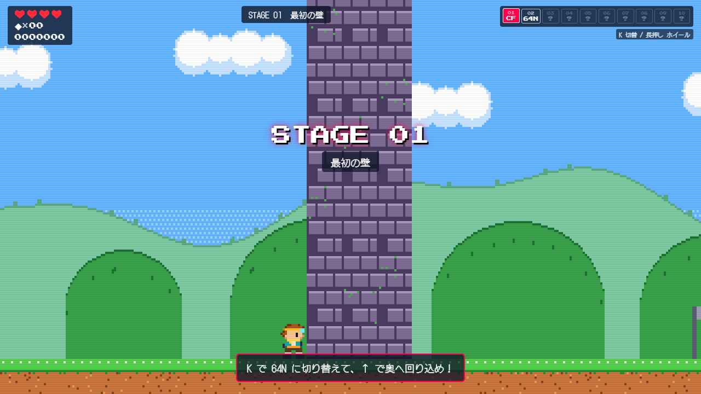

# BRIOMAROS（ブリオマロス）

**ゲームの歴史を、能力に変える。**

ゲームの表現媒体を切り替えると、世界の法則が変わるアクションゲーム（Phase 0 / Phase 1 テスト版）。
ボスを倒すたびに新しい媒体を獲得し、「さっきまで通れなかった場所が、媒体を変えるだけで通れる」体験を目指しています。

▶ **プレイ**: https://yuji5124.github.io/BRIOMAROS/ （GitHub Pages を有効化後に公開されます。下記「公開」を参照）



## 起動方法

Node.js 20 以上が必要です。

```bash
npm install
npm run dev        # http://localhost:5173
npm test           # 単体テスト（Vitest）
npm run test:e2e   # ブラウザE2Eテスト（Playwright。Windows はインストール済み Edge を使用）
npm run build      # 型チェック＋本番ビルド（dist/）
```

外部API・有料サービス・画像／音声ファイルは使っていません。ドット絵・ローポリモデル・地形・エフェクト・効果音・BGM はすべてコードで生成しています。

## 操作方法

| キー | 操作 |
| --- | --- |
| ← → | 移動 |
| ↑ ↓ | 奥行き移動（64N のみ） |
| Space | ジャンプ（長押しで高く。空中でも少し制御できる） |
| J | アクション（パンチ） |
| K | 媒体切替（短押し：次の媒体 / 長押し：媒体ホイール） |
| Enter | スタート |
| Esc / P | ポーズ |
| M | 音の ON / OFF |

媒体が増えても基本操作は変わりません。

### 開発者機能

`?dev=1` を付けて開く（または <kbd>`</kbd> キー）と開発者パネルが出ます。

- 媒体の強制切替（未獲得でも選べる）・全媒体獲得・無敵・当たり判定表示
- チェックポイントへのワープ（ボス1／巨大な壁／STAGE 02／ボス2／BG実験場／ゴール前）
- 操作感パラメータ（最高速度・加速・減速・空中制御・重力・ジャンプ初速・小ジャンプ倍率・コヨーテタイム等）を実行中に調整
- 数字キー: `1` `2` `3` = CF / 64N / BG 強制、`9` = 全媒体獲得、`0` = 無敵、`8` = 当たり判定

本編では未獲得の媒体は選べません。

## 実装済みの媒体

| 媒体 | 表現 | 世界の法則 |
| --- | --- | --- |
| **CF** クラシック2D | 320×180 のドット絵、限定パレット、横スクロール | z=0 の断面だけが世界。厚み0の“ドット足場”に乗れる |
| **64N** ローポリ3D | three.js、480×270 の低解像度、頂点スナップ＋15bitディザ | 奥行き方向へ移動できる。壁の裏・手前に回り込める。ドット足場は紙のように薄くて乗れない |
| **BG** モノクロ2D | 4階調の液晶風（CF のパレットを輝度で自動変換）、液晶グリッド | 色属性（赤）の攻撃と仕掛けが無効。物理攻撃（鉄球・岩・衝撃波）は有効 |

切替時は直前の画面がブロック状に崩れるエフェクトが入り、2D→3D では平面の見た目からカメラが引いて立体になります。ゲームの進行は切替中も止まりません。

## ステージ

- **STAGE 01 最初の壁** — CF で走る・跳ぶ・踏むを覚える → ボス1「ウォールガーディアン」（叩きつけの衝撃波・岩投げ。第2形態で3連投げと2段衝撃波）→ 64N 獲得 → 2D では越えられない巨大な壁を、64N で奥へ回り込んで突破。
- **STAGE 02 色の攻撃** — ドット足場（CF でだけ乗れる）と奥がふさがった壁（64N で手前から回る）を切り替えて進む → ボス2「カラーフォートレス」（赤い弾の連射・爆撃。オーバーヒートで着地したら反撃）→ BG 獲得 → 安全な実験場で赤い弾が無効になるのを確認 → 赤い光の柵を BG で通過 → 鉄球を投げる敵（BG でも防げない物理攻撃）→ ゴール。

敵: クリボット（歩く・気づいて追う。STAGE 02 では 3D 媒体で奥行きも追ってくる）、スパイクト（しゃがみ→トゲ付きジャンプ）、アイアンスロワー（鉄球／赤い弾）、実験用砲台。
すべての攻撃に予備動作（しゃがみ・振りかぶり・照準線・地面のマーカー）があります。

## 構成

```
src/
  core/      共通の型・座標変換(coords)・衝突判定(physics)・入力・Web Audio 合成・調整パラメータ(config)
  media/     媒体レジストリ（10媒体分の枠。法則 laws と操作感 move を持つ）
  world/     ステージデータ（共通座標の箱・敵・ボス・ヒント・チェックポイント）
  game/      ゲーム本体（主人公・敵/ボスのステートマシン・弾・進行）※描画を持たない
  render/
    pixel/     CF / BG 用 Canvas2D レンダラー、スプライト文字列、パレット
    lowpoly/   64N 用 three.js レンダラー、ローポリモデル、PS1風シェーダー
    transition.ts 媒体切替エフェクト
  ui/        HUD・開発者パネル
  dev/       自動操作ボット（E2E でゴール到達を確認する）
tests/unit   物理・媒体法則・進行のテスト（ブラウザ不要）
tests/e2e    Playwright（実ブラウザでのキー操作・スクリーンショット）
docs/        調査レポート・スクリーンショット
```

設計の要点:

- **共通世界データと描画の分離** — `Game` は状態だけを持ち、媒体ごとのレンダラーがそれを描く。
- **主人公の状態は媒体間で共通** — 位置・HP・獲得媒体・スコアは切替で変わらない。変わるのは `laws` と `move` だけ。
- **2D⇔3D の座標変換** — `src/core/coords.ts`。2D は z=0 断面を y 反転して 16px/タイルで写す。
- **埋まり込み防止** — 切替前に新しい法則で衝突を確認し、埋まるなら近くの安全な位置へ。なければ切替を拒否（`findSafeSpot`）。
- **10媒体への拡張** — `MEDIA` に定義を足してレンダラー種別を割り当てる。媒体ホイールは獲得済みリストから自動で並ぶ。

## 公開（GitHub Pages）

`.github/workflows/pages.yml` が `main` への push でテスト→ビルド→デプロイします。
初回のみリポジトリの **Settings → Pages → Build and deployment → Source** を **GitHub Actions** にしてください（管理者権限が必要）。

## 今後のロードマップ

- Phase 2: 操作感の実機調整（パラメータを開発者パネルで詰める）、64N のカメラ（壁際のカットアウェイ改善）、効果音の作り込み
- Phase 3: W&G（固定位置のコマ飛ばし）、SD（上下2画面）
- 将来: CS（多重スクロール）、3SD（立体視）、UW（非対称2画面）、IW（モーション操作）、SW（すべての媒体を統合）
- ステージの追加、ボスごとの媒体を使った弱点、ローポリ／ドット素材の差し替え（Blender MCP・GLB）

## クレジット・ライセンス

- 64N の頂点スナップ／15bit量子化シェーダー、BG の4階調量子化の考え方、シード付き乱数は
  [Yuji5124/visual-effect-library](https://github.com/Yuji5124/visual-effect-library)（MIT）から移植・改変。
- ビルド・E2E・Pages の構成は [Yuji5124/RANVORA](https://github.com/Yuji5124/RANVORA) を踏襲。
- [three.js](https://threejs.org/)（MIT）、フォント DotGothic16 / Press Start 2P（SIL Open Font License, Google Fonts）。
- キャラクター・敵・ステージ・音楽はすべてオリジナル。既存ゲームの素材は使用していません。

調査の詳細は [docs/RESEARCH.md](docs/RESEARCH.md) を参照。
